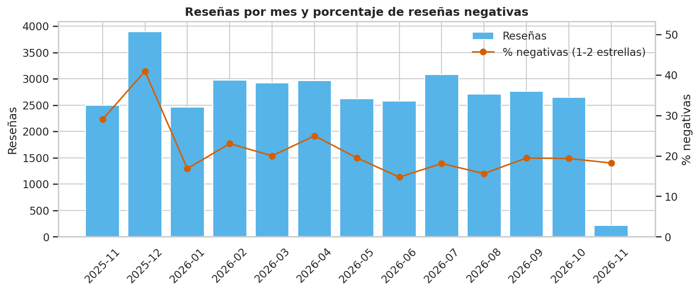
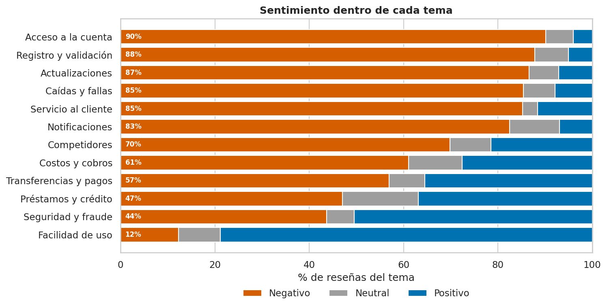
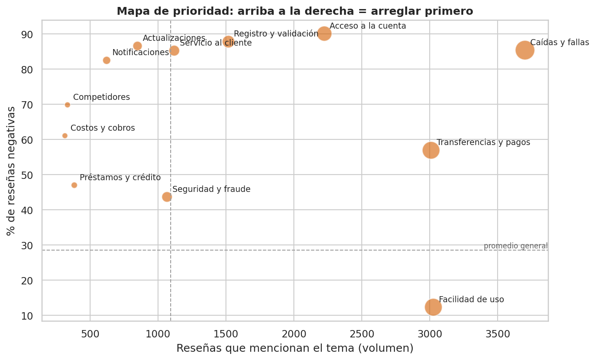
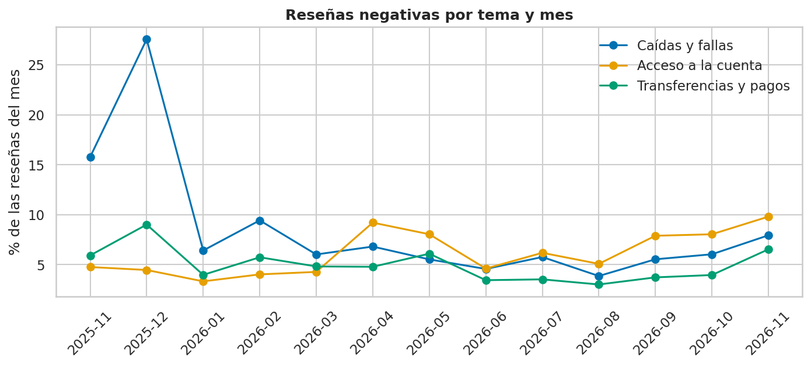
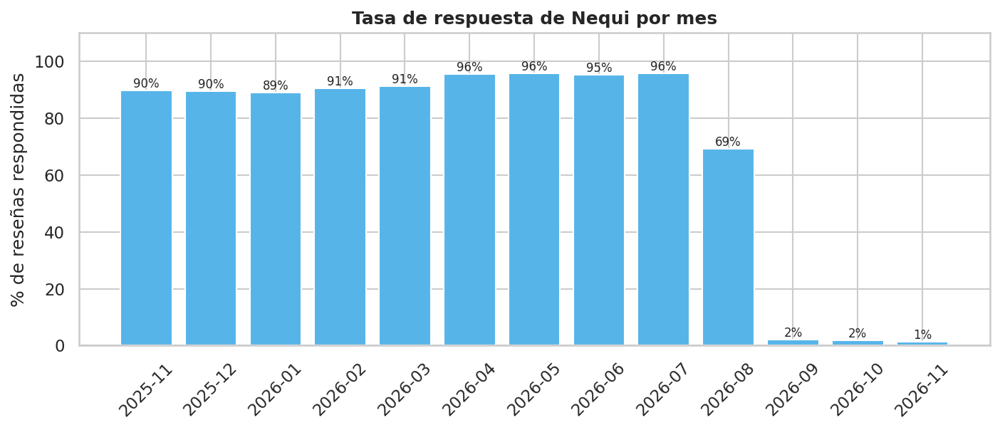

# Resumen ejecutivo — Lo que 34.328 usuarios le dicen a Nequi

**Pregunta de negocio:** ¿qué problemas dañan la experiencia de los usuarios de Nequi, cómo cambian en el tiempo y qué acciones debe priorizar la compañía para proteger su reputación en su nueva etapa independiente?

**Datos:** 34.328 reseñas públicas de Google Play Colombia (04/11/2025 – 03/11/2026), recolectadas con *web scraping*. Ninguna reseña fue eliminada en la limpieza.

---

## Indicadores clave

| Indicador | Valor |
|---|---|
| Sentimiento del texto (validado) | **57,1 %** positivo · 14,3 % neutral · **28,6 %** negativo |
| Tema más negativo | **Acceso a la cuenta:** 90,1 % negativas, y en aumento (3,3 % → 9,8 % de las reseñas en 2026) |
| Pico de crisis | **Diciembre de 2025:** las quejas por caídas fueron el 27,6 % de las reseñas del mes |
| Respuesta de Nequi en la tienda | **~96 %** (jul-2026) → **~2 %** (desde sep-2026) |

---

## 1. Diciembre de 2025: la crisis de las caídas

Diciembre concentró el mayor volumen de reseñas y el doble de negatividad del resto del año. Solo el 06/12/2025 llegaron 767 reseñas (81,4 % negativas), en fechas que coinciden con caídas reportadas por la prensa.

## 2. Cuando el usuario nombra un tema, casi siempre es una queja

Acceso a la cuenta, Registro, Actualizaciones, Caídas y Servicio al cliente superan el 85 % de menciones negativas. La **facilidad de uso** es la gran fortaleza: 78,8 % de menciones positivas.

## 3. Dónde actuar primero

**Caídas y fallas** (3.700 reseñas) y **Acceso a la cuenta** (2.224) combinan el mayor volumen con la mayor gravedad.

## 4. El problema que viene: quedarse por fuera de la cuenta

Las caídas explican la crisis de diciembre, pero las quejas de **acceso** crecen de forma sostenida y desde abril de 2026 superan a las caídas en varios meses.

## 5. Nequi dejó de responder

Hasta julio de 2026, Nequi respondía casi todas las reseñas en ~7 minutos, pero con plantillas (35 % de respuestas repetidas). Desde septiembre de 2026 responde ~2 %.

---

## Recomendaciones

| # | Estrategia | Acción principal | KPI |
|---|---|---|---|
| 1 | Actualizaciones sin sorpresas | Lanzamientos escalonados y pruebas obligatorias de inicio de sesión y notificaciones | Quejas de acceso: 9,8 % → < 5 % |
| 2 | Plan de quincena | Capacidad reforzada en días de pago y diciembre; aviso en la app durante caídas | Quejas por caídas en diciembre: 27,6 % → < 10 % |
| 3 | Soporte que resuelve | Responder primero las reseñas de 1-2 estrellas y de fraude, con número de caso | Respuesta a 1-2 estrellas: ~2 % → > 80 % |
| 4 | Registro sin fricción | Guías al tomar la foto y vía alternativa si falla el reconocimiento facial | Registros completados ↑ |
| 5 | Simple primero | Ninguna función nueva agrega pasos a enviar, recibir o pagar | Menciones positivas de facilidad ≥ 79 % |
| 6 | Escuchar el texto | Tablero mensual por tema y alerta de usuarios de 4-5 estrellas con quejas | Leales con fricción: 7,9 % → < 5 % |

---

## Cómo se obtuvo

Sentimiento con `pysentimiento` (modelo en español) más una capa de emojis, **validado con 260 reseñas revisadas a mano**: la exactitud estimada pasó de 61,4 % a 77,3 % tras corregir el error principal, y la corrección se confirmó al 92 % en una muestra nueva. Los temas se clasificaron con un diccionario y se contrastaron con un clustering de embeddings (K-Means, 6 grupos).

## Limitaciones

Solo usuarios de Android; reseñas autoseleccionadas; el modelo no detecta el sarcasmo y la clase Neutral sigue siendo poco confiable; la intención de abandono explícita es poco frecuente (47 reseñas).

---

*Detalle completo en `notebooks/02_analisis_nequi.ipynb` y en el `README.md`.*
